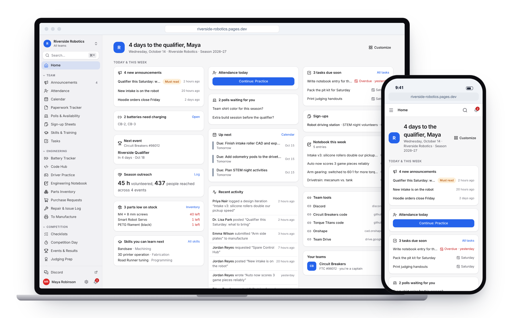

<div align="center">


# TeamHub FTC

**A team dashboard for *FIRST* Tech Challenge programs.**

Practices, tasks, the engineering notebook, scouting, competition day and outreach, all on one website for your
program. It's free and open source, and it runs on your own Supabase project and hosting.

[](https://github.com/elikorpus/teamhub-ftc/releases)
[](https://github.com/elikorpus/teamhub-ftc/actions/workflows/ci.yml)
[](LICENSE)
[](https://ftcscout.org/teams/23208)

[**Get started**](#get-started) · [All 27 tabs](docs/tabs/README.md) · [Docs](#documentation) · [Teams using TeamHub](docs/TEAMS.md)

</div>

<br>



<p align="center"><sub>A made-up program with made-up data, showing what a busy week looks like in TeamHub.</sub></p>

## Why teams use TeamHub

<table>
<tr>
<td width="33%" valign="top">

**Pick the tabs you need**<br>
Calendar, attendance, tasks, notebook, scouting, outreach hours and 21 more. Tabs you don't pick aren't added to
your site at all.

</td>
<td width="33%" valign="top">

**Free, and your data stays yours**<br>
It runs on a free Supabase project and free hosting (Cloudflare, Vercel, Netlify or GitHub Pages) that your team
owns. There's no TeamHub account to sign up for and nothing to pay.

</td>
<td width="33%" valign="top">

**About 30 minutes to set up**<br>
A setup wizard asks for your teams, colors, logos and tabs, creates your database and explains each hosting step.
You don't need to write any code.

</td>
</tr>
<tr>
<td valign="top">

**Live at competitions**<br>
During an event you see your next match and its estimated time, your partners and opponents, the rankings and your
pit notes. Results come from FTCScout and update every minute.

</td>
<td valign="top">

**Made with students in mind**<br>
There's no chat or private messaging. Private profile fields are only visible to the person and mentors, and forms
say who will see what you type.

</td>
<td valign="top">

**One dashboard for every team**<br>
Programs with several teams share one site. Permissions follow roles (member, captain, mentor) and positions like
"Outreach Lead", which can be given just the tools for that job.

</td>
</tr>
</table>

## A look inside

<table>
<tr>
<td width="50%"></td>
<td width="50%"></td>
</tr>
<tr>
<td><b>Competition Day.</b> Your next match, alliances, rankings and pit notes, live from FTCScout.</td>
<td><b>Tasks.</b> A board for the whole team and a list of your own tasks, with due dates and priorities.</td>
</tr>
<tr>
<td></td>
<td></td>
</tr>
<tr>
<td><b>Engineering Notebook.</b> Logs, design iterations and decision matrices you can export for judging.</td>
<td><b>Calendar.</b> Practices, competitions, outreach and deadlines, with feeds for families' phones.</td>
</tr>
<tr>
<td></td>
<td></td>
</tr>
<tr>
<td><b>Driver Practice.</b> Log practice runs and chart each driver pair's scores over the season.</td>
<td><b>Code Hub.</b> OpModes, driver controls and each team's latest commits.</td>
</tr>
</table>

## What's inside

27 optional tabs in four groups ([full list](docs/tabs/README.md)):

| Team | Engineering | Competition | Outreach & Business |
|---|---|---|---|
| Calendar, Attendance, Announcements, Tasks, Polls & Availability, Sign-up Sheets, Skills & Training, Paperwork Tracker | Engineering Notebook, To Manufacture, Parts Inventory, Purchase Requests, Battery Tracker, Repair & Issue Log, Driver Practice, Code Hub | Events & Results, Competition Day, Scouting, Checklists, Judging Prep, Rules Reference | Outreach Log, Sponsors CRM, Media Gallery, Social Media Planner, Merch & Orders |

Every dashboard also has **Home** (what's happening today, plus a Setup assistant that shows what's missing from your
profile), **People** (join requests, approvals and positions), **Links** (the team's tools and resources) and **Admin**
(storage use and keep-alive).

Two things worth knowing:

- **Scouting replaces Google Forms.** Pick a competition and its teams, rankings, matches and awards load from
  FTCScout and update during the event. Scouts fill in your team's own pit and match forms on their phones. A
  checklist shows which teams still need scouting, and there are comparisons and a pick list.
- **It fits in the free tier.** Photos are compressed before upload and old files are cleaned up automatically. A
  full season with every tab uses about 5 MB of the 500 MB free database.

## Get started

You need a computer with [Node.js](https://nodejs.org) 20.19+ and Git, a GitHub account and a free
[Supabase](https://supabase.com) account. Setup takes about 30 minutes.

1. **Make your own copy on GitHub (a "fork").** Sign in to GitHub, open
   [github.com/elikorpus/teamhub-ftc](https://github.com/elikorpus/teamhub-ftc) and click **Fork** (top right).
   - **Owner:** your team's or school's GitHub organization if you have one, otherwise your own account.
   - **Repository name:** your team or organization name followed by `-teamhub` is easy to recognize, for example
     `example-robotics-teamhub` or `team-12345-teamhub`.

   Then click **Create fork**. Your copy lives at `https://github.com/OWNER/REPOSITORY-NAME`.
2. **Download your copy to your computer** (use your fork's owner and name; the green **Code** button on your fork's
   page shows the exact link):

   ```sh
   git clone https://github.com/OWNER/REPOSITORY-NAME.git
   cd REPOSITORY-NAME
   ```

   For example: `git clone https://github.com/example-robotics/example-robotics-teamhub.git`.

3. **Install and start the setup wizard** (it opens http://localhost:4747 in your browser):

   ```sh
   npm install
   npm run setup
   ```

[Get your own copy](docs/setup-wizard.md#before-you-start-get-your-own-copy) has more detail, including naming, GitHub
Desktop and team accounts.


The wizard explains each step ([walkthrough](docs/setup-wizard.md)). When it's done, connect your fork to a host with
one of these guides:
[Cloudflare](docs/hosting/cloudflare.md), [Vercel](docs/hosting/vercel.md), [Netlify](docs/hosting/netlify.md) or
[GitHub Pages](docs/hosting/github-pages.md).

Later, run `npm run setup` again to **edit** your dashboard (add tabs, rebrand, change permissions), **update** to a
new TeamHub version ([how updates work](docs/updating.md)), back up and restore, or start a **new season**.

## Customize it with AI

For changes the wizard can't make, you can use an AI coding assistant. [`AGENTS.md`](AGENTS.md) explains how the code
is organized and which rules keep the dashboard safe; Claude Code, Cursor, GitHub Copilot, Codex and others read it
automatically. Your dashboard's **Admin > AI assistant** page has a prompt to paste in, with your program's name and
tabs already filled in.

## Documentation

- [Setup wizard walkthrough](docs/setup-wizard.md)
- [Updating your dashboard](docs/updating.md)
- [Hosting guides](docs/hosting/README.md)
- [Tab library](docs/tabs/README.md)
- [Configuration file reference](docs/configuration.md)
- [Testing](docs/testing.md)
- [Guide for AI coding assistants](AGENTS.md)
- [Contributing and writing a tab](.github/CONTRIBUTING.md)
- [Releasing (maintainers)](docs/releasing.md) and [changelog](docs/CHANGELOG.md)

## Try it locally

```sh
npm install
npm run dev:demo     # dashboard with every tab, using tools/examples/demo.config.json
```

`dev:demo` needs a Supabase project to sign in. Point `tools/examples/demo.config.json` at a throwaway project, or run the
mocked smoke tests: `npm run build:demo && npm run e2e`.

## Security

- Your Supabase URL and **publishable** key are meant to be public. Row-level security in your database decides who
  can read and change what, and every tab has tests for those rules.
- The wizard keeps your Supabase personal access token on your computer (in memory, or in
  `~/.teamhub/credentials.json` if you choose "remember"). It's only sent to Supabase and never committed.
- If you find a security problem, please report it privately as described in [SECURITY.md](.github/SECURITY.md).

## Using TeamHub?

[Add your team](https://github.com/elikorpus/teamhub-ftc/issues/new?template=teamhub-team.yml) to the
[list of teams using TeamHub](docs/TEAMS.md).

## License

MIT (see [LICENSE](LICENSE)). You can use, change and share TeamHub as long as your copy keeps the copyright notice
crediting FTC Team 23208. Please also leave the small "made by FTC Team 23208" line on the login page.
