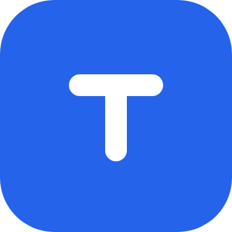
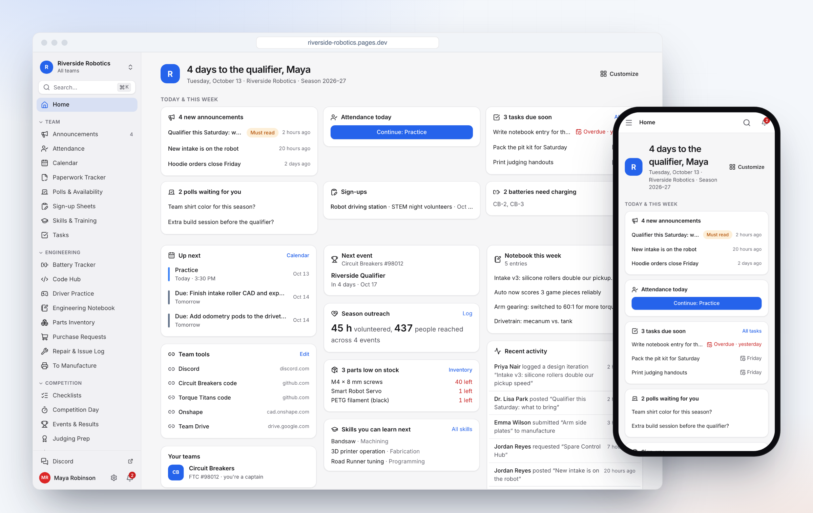
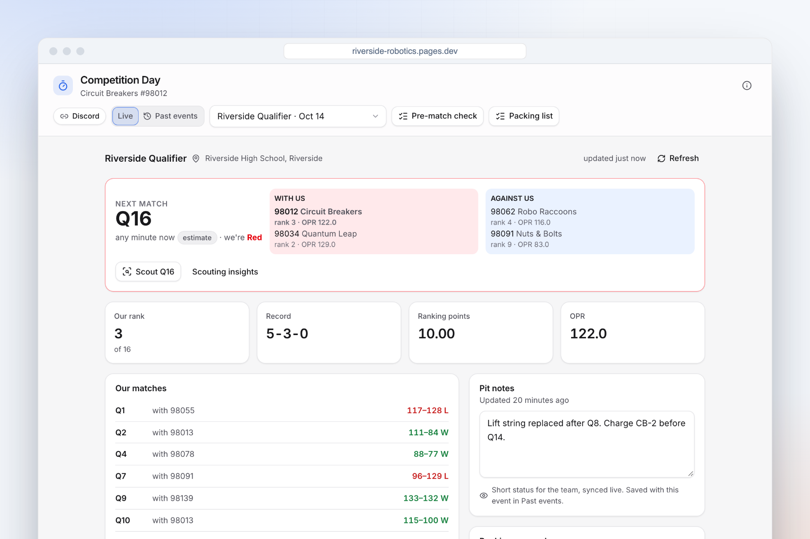
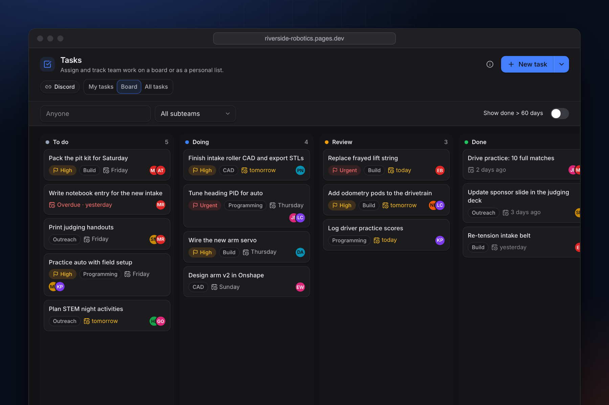
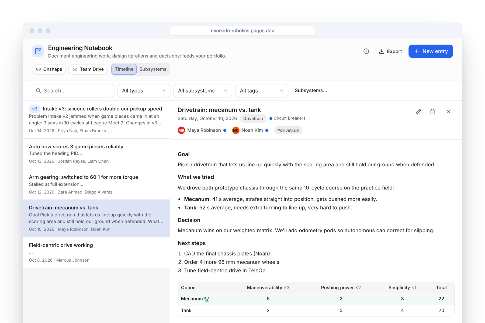
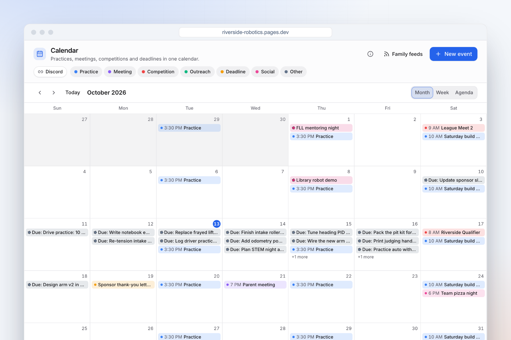
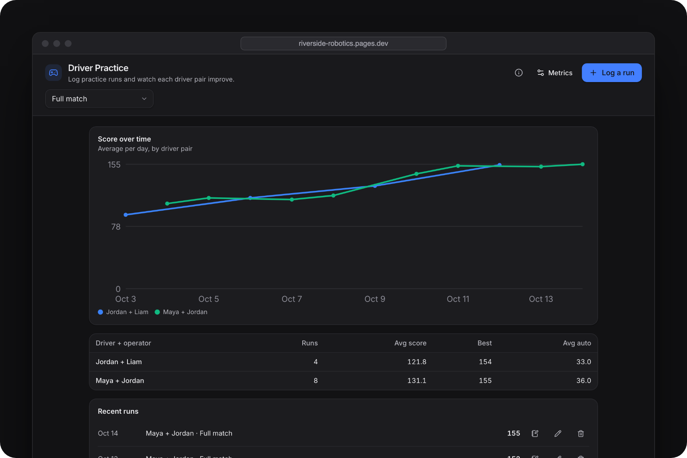
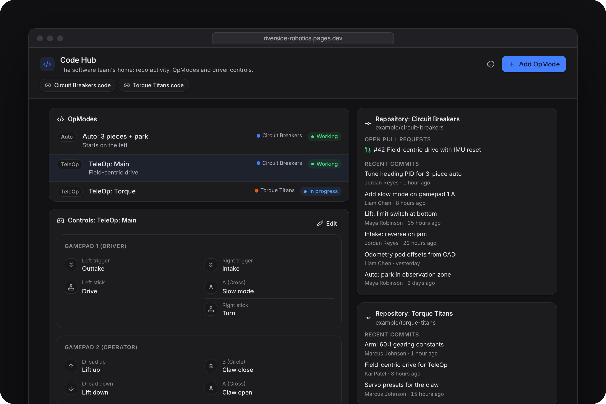
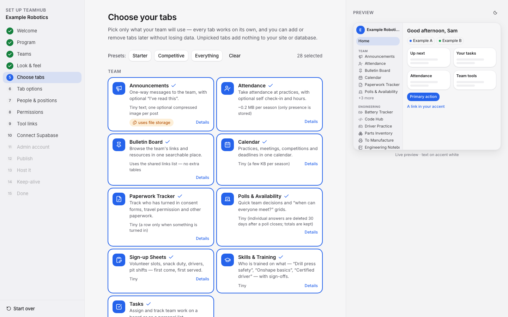

<div align="center">



# TeamHub FTC

**One home for your whole *FIRST* Tech Challenge program.**

Practices, tasks, the engineering notebook, scouting, competition day and outreach, in one dashboard your
students actually open. Free and open source, running on your own Supabase and hosting.

[](https://github.com/elikorpus/teamhub-ftc/releases)
[](https://github.com/elikorpus/teamhub-ftc/actions/workflows/ci.yml)
[](LICENSE)
[](https://ftcscout.org/teams/23208)

[**Get started**](#get-started) · [All 27 tabs](docs/tabs/README.md) · [Docs](#documentation) · [Teams using TeamHub](docs/TEAMS.md)

</div>

<br>

<picture>
  <source media="(prefers-color-scheme: dark)" srcset="docs/screenshots/hero-dark.png">
  
</picture>

<p align="center"><sub>A made-up program with made-up data, showing what a busy week looks like in TeamHub.</sub></p>

## Why teams use TeamHub

<table>
<tr>
<td width="33%" valign="top">

**Everything in one place**<br>
Calendar, attendance, tasks, notebook, scouting, outreach hours and more. Choose only the tabs you need; the rest
add nothing to your site.

</td>
<td width="33%" valign="top">

**Yours, and free**<br>
Runs on your own free Supabase project and free hosting (Cloudflare, Vercel, Netlify or GitHub Pages). No accounts
with us, no fees, no data leaving your control.

</td>
<td width="33%" valign="top">

**Set up in 30 minutes**<br>
A friendly setup wizard collects your teams, colors, logos and tabs, builds your database and walks you through
hosting. No coding needed.

</td>
</tr>
<tr>
<td valign="top">

**Built for competition day**<br>
Your next match with a live time estimate, who's with and against you, rankings and pit notes, pulled from FTCScout
and refreshed during the event.

</td>
<td valign="top">

**Safe for students**<br>
No chat or private messages, private profile fields only mentors can see, and every form says who will see what you
type.

</td>
<td valign="top">

**Fits how your program works**<br>
Several teams in one dashboard, members, captains and mentors, plus positions like "Outreach Lead" that unlock
exactly their part.

</td>
</tr>
</table>

## A look inside

<table>
<tr>
<td width="50%"></td>
<td width="50%"></td>
</tr>
<tr>
<td><b>Competition Day.</b> Your next match, alliances, rankings and pit notes, live from FTCScout.</td>
<td><b>Tasks.</b> A board for the team and a simple list of what's yours, with due dates and priorities.</td>
</tr>
<tr>
<td></td>
<td></td>
</tr>
<tr>
<td><b>Engineering Notebook.</b> Logs, design iterations and decision matrices, ready for judges.</td>
<td><b>Calendar.</b> Practices, competitions, outreach and deadlines, with feeds for families' phones.</td>
</tr>
<tr>
<td></td>
<td></td>
</tr>
<tr>
<td><b>Driver Practice.</b> Log runs and watch each driver pair improve.</td>
<td><b>Code Hub.</b> OpModes, driver controls and each team's latest commits.</td>
</tr>
</table>

## What's inside

27 optional tabs in four groups ([full list](docs/tabs/README.md)):

| Team | Engineering | Competition | Outreach & Business |
|---|---|---|---|
| Calendar, Attendance, Announcements, Tasks, Polls & Availability, Sign-up Sheets, Skills & Training, Paperwork Tracker | Engineering Notebook, To Manufacture, Parts Inventory, Purchase Requests, Battery Tracker, Repair & Issue Log, Driver Practice, Code Hub | Events & Results, Competition Day, Scouting, Checklists, Judging Prep, Rules Reference | Outreach Log, Sponsors CRM, Media Gallery, Social Media Planner, Merch & Orders |

Plus the core every dashboard has: **Home** (your day at a glance, and a Setup assistant that shows how complete your
profile is), **People** (join requests and approval, positions), **Links** (the team's tools and resources) and **Admin** (storage meters, keep-alive).

Highlights:

- **Scouting without Google Forms.** Pick the competition and every team, ranking, match and award loads from
  FTCScout and refreshes live during the event. Your scouts fill in team-built pit and match forms on their phones,
  with a checklist showing which teams still need scouting, plus insights, comparisons and a pick list.
- **Built for the free tier.** Photos are compressed in the browser, old files are cleaned up automatically, and a
  full season with every tab uses about 5 MB of the 500 MB free database.

## Get started

You need a computer with [Node.js](https://nodejs.org) 20.19+ and Git, a GitHub account and a free
[Supabase](https://supabase.com) account. Setup takes about 30 minutes.

1. **Make your own copy on GitHub (a "fork").** Sign in to GitHub, open
   [github.com/elikorpus/teamhub-ftc](https://github.com/elikorpus/teamhub-ftc) and click **Fork** (top right).
   - **Owner:** your team's or school's GitHub organization if you have one, otherwise your own account.
   - **Repository name:** we suggest your team or organization name followed by `-teamhub`, for example
     `example-robotics-teamhub` or `team-12345-teamhub`. It keeps your copy easy to recognize.

   Then click **Create fork**. Your copy lives at `https://github.com/OWNER/REPOSITORY-NAME`.
2. **Download your copy to your computer** (use your fork's owner and name; the green **Code** button on your fork's
   page shows the exact link):

   ```sh
   git clone https://github.com/OWNER/REPOSITORY-NAME.git
   cd REPOSITORY-NAME
   ```

   For example: `git clone https://github.com/example-robotics/example-robotics-teamhub.git`.

3. **Install and start the setup wizard** (it opens http://localhost:4747 in your browser):

   ```sh
   npm install
   npm run setup
   ```

More detail, including naming, GitHub Desktop and team accounts: [Get your own copy](docs/setup-wizard.md#before-you-start-get-your-own-copy).



The wizard explains every step ([walkthrough](docs/setup-wizard.md)). When it's done, connect your fork to a host:
[Cloudflare](docs/hosting/cloudflare.md), [Vercel](docs/hosting/vercel.md), [Netlify](docs/hosting/netlify.md) or
[GitHub Pages](docs/hosting/github-pages.md).

Later, run `npm run setup` again to **edit** your dashboard (add tabs, rebrand, change permissions), **update** to a
new TeamHub version ([how updates work](docs/updating.md)), back up and restore, or start a **new season**.

## Customize it with AI

Want changes the wizard can't make? [`AGENTS.md`](AGENTS.md) explains the codebase and its safety rules to AI coding
assistants (Claude Code, Cursor, GitHub Copilot, Codex and others read it automatically). Your dashboard's
**Admin > AI assistant** page has a ready-to-paste prompt with your program's name and tabs filled in.

## Documentation

- [Setup wizard walkthrough](docs/setup-wizard.md)
- [Updating your dashboard](docs/updating.md)
- [Hosting guides](docs/hosting/README.md)
- [Tab library](docs/tabs/README.md)
- [Configuration file reference](docs/configuration.md)
- [Testing](docs/testing.md)
- [Guide for AI coding assistants](AGENTS.md)
- [Contributing and writing a tab](.github/CONTRIBUTING.md)
- [Releasing (maintainers)](docs/releasing.md) and [changelog](docs/CHANGELOG.md)

## Try it locally

```sh
npm install
npm run dev:demo     # dashboard with every tab, using tools/examples/demo.config.json
```

`dev:demo` needs a Supabase project to sign in. Point `tools/examples/demo.config.json` at a throwaway project, or run the
mocked smoke tests: `npm run build:demo && npm run e2e`.

## Security

- Your Supabase **publishable** key and URL are public by design; row-level security in your database decides who
  can read and write what. Every tab ships with tests for those rules.
- The wizard uses your Supabase personal access token only on your computer (in memory, or in
  `~/.teamhub/credentials.json` if you choose "remember"). It's never committed or sent anywhere except Supabase.
- Found a security issue? Please report it privately; see [SECURITY.md](.github/SECURITY.md).

## Using TeamHub?

We'd love to hear about it. [Add your team](https://github.com/elikorpus/teamhub-ftc/issues/new?template=teamhub-team.yml) to the
[list of teams using TeamHub](docs/TEAMS.md).

## License

MIT. See [LICENSE](LICENSE). You're free to use, change and share TeamHub. The license asks one thing in return: keep
the copyright notice crediting FTC Team 23208 in your copy. Please also leave the small "made by FTC Team 23208" line
on the login page.
